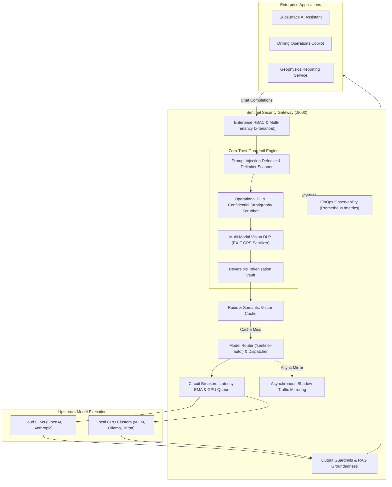

# Architecture

## Overview

AI Gateway Sentinel is a high-performance, containerized enterprise security proxy and governance control plane situated between enterprise applications and upstream Large Language Models (LLMs).

## Network Boundaries & Data Flow

- **Ingress**: All inbound enterprise traffic arrives at Sentinel on port `8000` via mutual TLS / private network.
- **Egress**: Sanitized prompts are forwarded to upstream LLM endpoints over secure outbound HTTPS.
- **Cache**: Redis runs on an isolated internal Docker bridge network (`sentinel-network`), inaccessible from the public internet.
- **Observability**: Prometheus scrapes `/metrics` on port `8000`, displayed via an internal Grafana instance (`:3000`).
